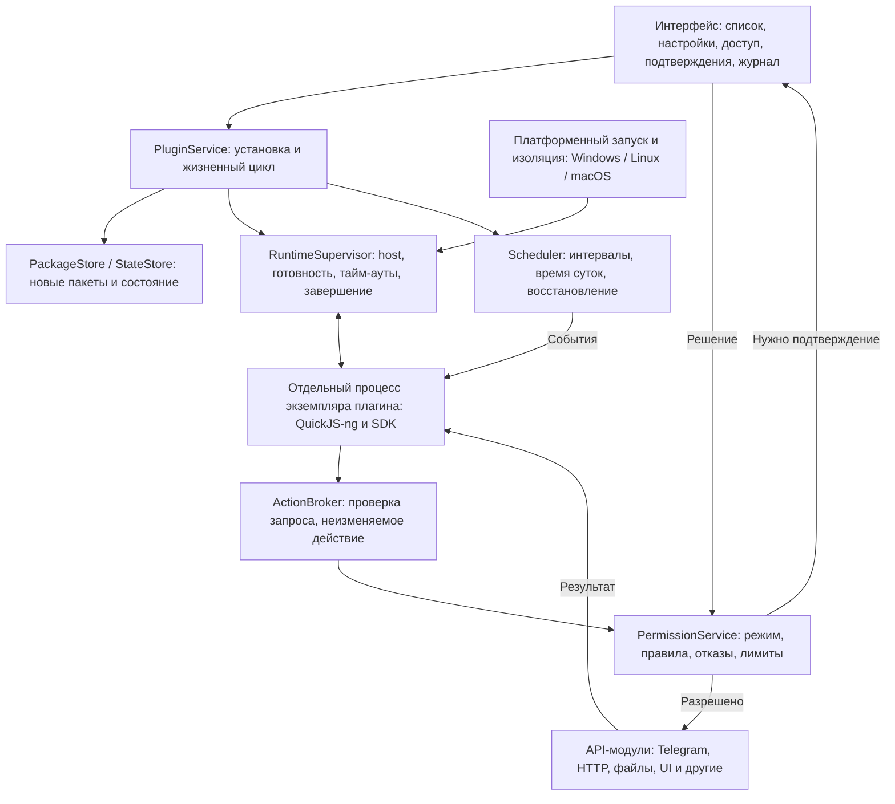
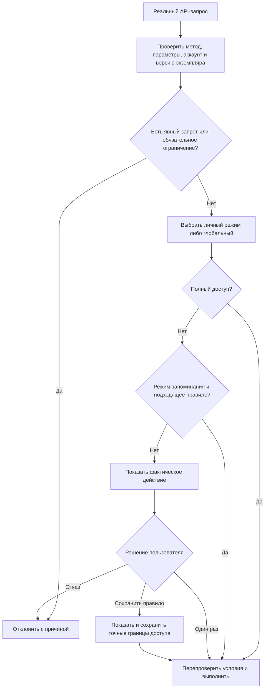
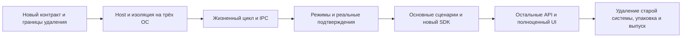

# JellyPlugins v2: план реализации

Обновлён: 12 ноября 2026 года. Статус: новая система подключена к исходникам, старый runtime удалён, подготовлены платформенные Actions и упаковка. Нативное исполнение и UI на трёх ОС ещё не проверены.

## 1. Результат

Один пакет `.jelly` работает одинаково в поддерживаемых сборках Windows, Linux и macOS. Автор пишет TypeScript/JavaScript и использует стабильный API. Пользователь устанавливает пакет, настраивает сценарий и выбирает режим доступа глобально либо для конкретного плагина. Клиент показывает фактические операции, проверяет разрешения и останавливает неисправный плагин без зависания приложения.

Готовность означает проверку установленных сборок на трёх ОС. Успешные тесты SDK или компиляция сами по себе этого не подтверждают. Минимальные версии ОС и поддерживаемые варианты упаковки фиксируются после платформенного прототипа, до реализации остального API.

Сохраняем названия GummyGram и JellyPlugins и внутренние идентификаторы jel/Jel. Новая система создаётся без совместимости со старой: API 1, старые пакеты, настройки и разрешения плагинов не переносятся. Старую реализацию удаляем при замене. Данные аккаунтов и соседние подсистемы клиента не затрагиваются.

## 2. Исходная точка до замены (перечисленные старые файлы удалены)

- `Telegram/SourceFiles/jel/plugins/plugin_package.*`: пакеты, формат, разрешения, настройки.
- `plugin_manager.*`: жизненный цикл, Telegram, HTTP, файлы, баланс, Mini Apps, UI, таймеры, лимиты и сохранение. Ответственности требуется разделить.
- `plugin_worker.*`: QJSEngine и JSON-протокол.
- `plugin_sandbox.*`: Windows AppContainer, Job Object, копирование runtime; другие ОС блокируются.
- `Telegram/SourceFiles/jel/ui/settings/settings_plugins.*`: интерфейс управления.
- `jellyplugins/sdk`, `scripts`, `examples`, `tests`: публичные типы, runtime, упаковка и проверки.
- `Telegram/cmake/lib_quickjs.cmake`: уже подключён TelegramMessenger fork QuickJS-ng из widget-sandbox. Его точную ревизию и пригодность нужно проверить; независимую копию движка без причины не добавлять.

Исходная реализация служит справочным материалом; сохранять её код, формат или ограничения ради совместимости не требуется. План не предусматривает параллельную поддержку двух runtime. Чужие незакоммиченные изменения не включаются в переработку.

## 3. Архитектура



Компоненты реализуются внутри текущего C++/Qt-проекта. Отдельные сервисы, сервер, Node.js, Python и дополнительный язык для исполнения плагинов не нужны. Внутренние интерфейсы вводятся по реальным границам ответственности; отдельный класс на каждый метод не требуется.

### Исполнение

- Небольшой `jelly-plugin-host` поставляется вместе с приложением; основной Telegram/GummyGram executable больше не копируется ради плагина.
- Изоляция исполнения: отдельный процесс и JSRuntime на экземпляр `(аккаунт, плагин)`. На macOS допустим иной транспорт, но эквивалентное разделение экземпляров обязательно доказать прототипом.
- Один закреплённый движок на трёх ОС. Нативные модули, Node.js API, самостоятельный доступ к сети, процессам и файлам не экспортируются.
- Плагин поставляет исходный JavaScript; недоверенный QuickJS bytecode не загружается.
- Ограничиваются память JS, стек, время выполнения, количество и размер запросов, очередь событий. Отдельный watchdog завершает зависший host, включая зависание вне JS interrupt handler.
- Promise/microtask-очередь исполняется с бюджетом; асинхронная активация должна явно завершиться. Heartbeat и ответы транспорта не означают успешную активацию.
- Qt Qml удаляется из зависимостей плагинов после замены QJSEngine; из проекта целиком — только если аудит подтвердит отсутствие других потребителей.

### Платформенный слой

| ОС | Базовый вариант | Что проверить до выбора окончательной реализации |
|---|---|---|
| Windows | AppContainer, Job Object, явный список наследуемых IPC handles | Чистая/portable установка, путь с Unicode, стандартный пользователь, окружение запуска, ACL небольшого host, отказ доступа к данным аккаунта и прямой сети |
| Linux | Минимальный host, `no_new_privs`, seccomp, ограничения ресурсов; Landlock либо иной проверенный способ ограничения файлов | Возможности ядра, библиотеки и загрузчик, IPC, запрет файлов/сети/дочерних процессов, AppImage и пакеты; Flatpak — если он входит в выпуск |
| macOS | Подписанный host либо XPC service с собственной App Sandbox-конфигурацией | Реальный запуск из подписанного `.app`, Intel/Apple Silicon по поддержке клиента, IPC, разделение экземпляров, entitlements, notarization, отсутствие доступа к сессии и прямой сети |

QuickJS API и отдельный процесс не заменяют системную изоляцию. Возможность Linux/macOS — обязательный результат первого прототипа. Нельзя объявить ОС поддержанной, оставив заглушку, либо незаметно запускать плагин без выбранных обязательных ограничений. Если механизм недоступен, клиент сообщает конкретную причину и способ исправления; поддерживаемые конфигурации публикуются явно.

## 4. Режимы доступа

Глобальный режим действует на все существующие и новые плагины, выбравшие наследование. Индивидуальный режим имеет приоритет. Глобальная настройка хранится на уровне клиента; конкретные правила и доступ к данным изолированы по аккаунтам.

| Режим | Поведение |
|---|---|
| Спрашивать перед действием | Каждый запрос с внешним эффектом или получением защищённых данных требует подтверждения. Доступна кнопка «Разрешить один раз»; сохранение правила предлагает перейти в режим запоминания для этого плагина |
| Запоминать разрешённые действия | Подходящее сохранённое правило разрешает действие автоматически. Иначе показывается фактическое действие с выбором однократного либо постоянного разрешения |
| Полный доступ к API клиента | Поддерживаемые API-операции выполняются без отдельных подтверждений. Изоляция процесса, корректность параметров, технические лимиты и неизменяемые запреты продолжают действовать |

Индивидуальная настройка дополнительно содержит «Как в общих настройках». Рекомендуемый начальный глобальный режим — «Запоминать разрешённые действия».

Полный доступ не предоставляет tdata, ключи сессии, shell, произвольные нативные объекты или доступ ко всей файловой системе. Он не отменяет смысл методов с обязательным выбором файла пользователем и не делает поддерживаемыми платёжные или иные отсутствующие операции. Интерфейс перечисляет доступные категории API перед включением полного доступа.

Явный запрет конкретного действия имеет приоритет над полным доступом; исключения видны рядом с режимом. Кнопки «Остановить все» и отключения отдельного плагина действуют независимо от режимов.

Глобальное включение полного доступа показывает число затрагиваемых плагинов и предупреждает о будущих установках с наследованием. Изменение глобального режима не перезаписывает индивидуальные исключения. Решения сохраняются локально и явно отображаются в карточке.



## 5. Подтверждение реальных действий

1. Клиент декодирует запрос и проверяет типы, размеры и доступность операции.
2. API-модуль формирует типизированное неизменяемое действие: метод, аккаунт, получатель, содержимое и все значимые параметры.
3. Заголовок и текст окна собираются из этого действия средствами клиента. Описание и имя автора из манифеста не служат доказательством поведения. Текст плагина отображается отдельно как недоверенные сведения.
4. Решение привязывается к ID запроса, digest пакета и поколению экземпляра. После подтверждения выполняется тот же запрос; подмена параметров исключается.
5. Перед выполнением повторно проверяются актуальные права, остановка/обновление плагина, лимиты и доступность получателя. Неоднозначные имена чатов сопровождаются ID и аккаунтом.

Для отправки показываются чат, полный текст, наличие вложения, ответ на сообщение и режим уведомления. Для истории — чат и объём данных; для подписки — какие будущие сообщения начнут поступать. Для HTTP — адрес, метод и параметры, которые уходят на сервер. Для действия бота поясняется реальная операция нажатия; неизвестный последующий эффект бота не выдаётся за проверенный.

Режим подтверждений не должен отдавать защищённые данные до решения: это относится к истории, входящим событиям, балансу и файлам, а не только к отправке сообщений. Доступ к потоку входящих событий подтверждается как подписка, а не отдельным окном на каждое сообщение.

Сохранение правила всегда показывает ширину доступа. Примеры:

- Этот метод, этот чат, точный согласованный текст, не чаще раза в час.
- Отправлять любой текст в этот чат — только после явного выбора пользователем.
- Читать историю выбранного чата в установленном диапазоне лимита.
- HTTP GET на выбранный origin; разрешение всего сайта и точного URL различается явно.

Неучтённый параметр не должен автоматически считаться разрешённым. Для вложений и исходных сообщений повторно проверяется идентичность ресурса; если содержимое изменилось, требуется новое решение. Превью файлов строится по зафиксированному ресурсу, а не по изменяемому пути.

Ожидание подтверждения имеет ограниченную очередь, отмену и отдельный тайм-аут. Оно не расходует бюджет исполнения JS и не вызывает автоматическое повторное выполнение. При закрытом окне приложения появляется индикатор ожидающего решения, без бесконечной серии всплывающих окон. Запросы объединяются визуально только при сохранении отдельных параметров и решений.

## 6. API и протокол

### Ядро v2

- Жизненный цикл: активация, готовность, остановка, ошибка и очистка обработчиков.
- Telegram: отправка текста, входящие события, история и базовые действия с сообщениями.
- Расписание, настройки, собственное хранилище и журнал.
- HTTP с проверкой URL, разрешений, TLS, редиректов и адресов назначения.
- Декларативный UI: кнопки, меню сообщений, формы, уведомления и диалоги.

Файлы, вложения, баланс, Mini Apps, вступление в каналы и действия ботов рассматриваются как отдельные дополнительные модули. Их включение определяется полезными сценариями новой системы; воспроизводить весь старый API не требуется. Произвольный raw MTProto, внутренние указатели клиента и установка нативных зависимостей в v2 не вводятся.

Методы, права, валидаторы и представление реального действия описываются в общем реестре. Из него формируются SDK-типы и идентификаторы разрешений; специфическая логика остаётся в API-модуле. Не поддерживать несколько расходящихся списков методов вручную.

### IPC

- Отдельные версии формата пакета, API и протокола исполнения; handshake согласует совместимость и возможности.
- Ограниченные кадры с длиной и JSON-полезной нагрузкой, частичное чтение/запись, очередь с обратным давлением. Журнал не смешивается с транспортом.
- ID экземпляра, поколение, ID запроса; неподходящие и запоздалые ответы отбрасываются.
- Ответы структурированы: `code`, сообщение, возможность повтора, `retryAfter` и стадия ошибки.
- Тайм-ауты запуска, активации, исполнения, API-запроса и ожидания пользователя различаются.
- Остановка и отзыв прав отменяют ещё не выполненные операции. Уже принятую сервером операцию отменённой не объявлять.
- Исходящие вызовы исполняются по ограниченной очереди. Глобальные и аккаунтные лимиты не позволяют умножать нагрузку установкой копий плагина.
- При сетевом разрыве после возможного принятия сообщения возвращается «результат неизвестен»; автоматический повтор не выполняется. Exactly-once не обещается.

Первоначальные бюджеты памяти, времени и очередей устанавливаются по измерениям на тестовых сценариях, а затем закрепляются в спецификации и тестах. Случайные значения не разбрасываются по модулям.

## 7. Расписание

- Поддержать интервалы; расписание по времени суток добавлять после работающих интервалов с явным часовым поясом и поведением при переходах времени.
- В настройке явно указать первую отправку: сразу либо после периода. По умолчанию — после периода.
- Интервалы внутри работающего процесса рассчитывать монотонными часами. Для сохранения следующего запуска использовать дату и явную политику восстановления.
- По умолчанию пропущенные во сне/офлайне тики пропускаются; шквал накопившихся действий не выполняется.
- Выполнение одного задания не пересекается само с собой. Параллельность иных обработчиков документируется и ограничивается.
- Сохраняемые задания привязаны к аккаунту, пакету и версии схемы; после обновления/отзыва доступа не запускаются по старому разрешению.
- «Следующий запуск» показывается, если известен Scheduler. Регистрация таймера не выдаётся за доказательство будущей отправки сообщения.
- После закрытия GummyGram плагины не работают. Системный фоновый сервис не входит в v2; это явно написано в UI.
- Долгое ожидание подтверждения не вызывает дополнительный экземпляр той же отправки. FloodWait соблюдается общим диспетчером аккаунта.

## 8. Пакеты, обновления и данные

Сохранить расширение `.jelly`. Формат v2: версионированный контейнер с манифестом, JavaScript и ограниченными ресурсами; выбор JSON либо архива принять после проверки действительных потребностей в ресурсах. Если вводится архив, нужны ограничения распаковки, проверка путей, дубликатов и символических ссылок.

Манифест задаёт идентификатор, имя, версию, API-диапазон, точку входа, схему настроек и необходимые категории возможностей. Он сообщает намерения автора, но сам не выдаёт права. Незапрошенный метод обрабатывается по реальному запросу и режиму доступа; несовместимый или отсутствующий API возвращает структурированную ошибку.

ID плагина и строка автора не подтверждают личность издателя. Для локальных неподписанных пакетов показывать этот статус; пакет с тем же ID не может незаметно унаследовать доверие только из-за совпадения строки.

- Установка сама по себе не запускает код. Повторная установка сравнивает digest и показывает замену.
- Обновление устанавливается атомарно; сохраняется предыдущий пакет для отката. Новая ревизия проходит явное включение/подтверждение переноса доверия.
- Личный полный доступ и запомненные правила не переносятся на изменённый код молча. Глобальный полный режим не обходит проверку замены пакета; после подтверждения новой ревизии применяется наследуемый режим.
- Появление новых категорий API при обновлении клиента требует отдельного решения о расширении ранее выданного полного доступа.
- Настройки, данные, правила, журналы и лимиты разделены по аккаунтам. Код пакета можно хранить один раз, но состояние экземпляров не объединяется.
- Сохранение атомарное, с версией схемы и восстановлением после сбоя. Данные неизвестного формата не перезаписываются пустым объектом.
- Откат обновления нового плагина должен восстанавливать согласованный снимок его кода и состояния; откат к старой системе плагинов не предусматривается.
- Удаление предлагает явно выбрать удаление пользовательских данных. Экспорт настроек не включает ключи сессии, сохранённые разрешения и полный доступ по умолчанию.

## 9. Интерфейс

### Общая страница

Список плагинов с именем, состоянием и коротким результатом последнего действия. Сверху: установка, глобальный режим доступа, ожидающие подтверждения и «Остановить все». Наследуемый/личный режим и полный доступ видны без открытия вложенных настроек.

### Карточка плагина

```text
Мой плагин                              Работает
GummyGram · 1.0.0 · локальный пакет

Следующий запуск: сегодня, 21:00
Последняя отправка: 20:00 — принято Telegram

Режим доступа          Как в общих настройках   >
Сохранённые правила    1 правило                 >
Настройки                                       >
Журнал                                          >
Код, версия и сведения                          >

                                   [ Остановить ]
```

Для универсального плагина «последняя отправка» заменяется фактическим последним действием, а неизвестный следующий запуск не придумывается. Заголовки, вторичные сведения и основной текст имеют явную визуальную иерархию. Длинные названия и подписи переносятся. Дополнительные действия не помещаются все в нижний ряд кнопок.

Состояния: установлен/выключен, запускается, работает, ожидает подтверждения, остановлен, ошибка. Состояние хранится типом с кодом причины, а локализованный текст формирует UI. Восстановление после сбоя и ожидание доступа не маскируются статусом «Работает».

Настройки: нормальные поля, переключатели, выбор чатов, сайтов и расписания. JSON — дополнительный редактор. Просмотр кода: моноширинный шрифт, поиск, копирование, номера строк; отображается именно установленная версия, а TypeScript показывается только при наличии соответствующего источника. Журнал различает пользовательские события и диагностику, скрывает чувствительное содержимое по умолчанию.

Ошибки дают понятную причину, код для диагностики и доступное действие: повтор запуска, изменение доступа, открытие журнала. Проверяются клавиатура, фокус, screen reader, светлая/тёмная тема, масштабирование, узкое окно и русская/английская локализация. Полноразмерная визуальная проверка обязательна.

## 10. Новый SDK и удаление старой системы

- Определить новый API и формат пакета по нужным сценариям, без адаптера API 1 и без поддержки старого IIFE `JellyPlugin.default`.
- Удалить старые manager/worker/sandbox, интеграцию запуска, SDK runtime, упаковщик, примеры, тесты и документацию в той части, которую заменяет новая система. Общие зависимости других подсистем не удалять.
- Старые пакеты отклоняются с понятным сообщением о неподдерживаемом формате; не исполняются и не получают старые разрешения. Импорт настроек, правил и состояния старой системы не реализуется.
- Старые каталоги данных плагинов не используются новым runtime. Их очистку реализовать отдельно в строго ограниченном каталоге плагинов; данные Telegram-аккаунта и пользовательские файлы вне него не затрагивать.
- Написать нейтральный пример hello под новый SDK. Сквозные проверки расписания и Telegram выполнять тестовыми сценариями с перехватом API. Другие примеры добавлять по выбранному объёму API, без обязательного повторения всех старых примеров.
- SDK предоставляет типы, упаковку, валидацию и проверку совместимости пакета с клиентом.
- Тестовый запуск использует подменённые адаптеры действий и явно помечен. Он не доказывает поведение произвольного скрипта во всех будущих условиях.
- Проверки SDK дополняются тестами настоящего host: Node.js VM не подтверждает совместимость с QuickJS.
- Документация RU/EN описывает новую установку, доступ, режимы, ограничения и полноценные примеры. Старые инструкции заменяются; руководство по миграции не требуется. Публичные страницы отделены от заметок сопровождающим.
- Готовые пользовательские `.jelly` в этой рабочей среде складываются в `C:\Users\aver\Documents\JellyPlugins`; это место доставки, не внутренний runtime-каталог клиента.

## 11. Этапы и критерии завершения

| Этап | Работа | Обязательный результат |
|---|---|---|
| 0. Зафиксировать контракт | Новый API и формат пакета, модель режимов, IPC, поддержка платформ и границы удаления старого кода | Документированные контракты, выбранный объём функций и проверяемые критерии без обязательств совместимости с v1 |
| 1. Host на трёх ОС | QuickJS, handshake, тестовый плагин, платформенный запуск, упаковка и ограничения | Один пакет реально активируется на Windows/Linux/macOS; зависание и выход host не ломают клиент; ограничения проверены |
| 2. Управление и протокол | Состояния, очереди, отмена, crash recovery, лимиты и ошибки | Готовность после async activation; устаревшие ответы и некорректные кадры отклоняются |
| 3. Доступ и реальные действия | Глобальный/личный режим, типизированные действия, подтверждения и сохранённые правила | Все сочетания режимов проверены; разрешённый запрос нельзя подменить; чтение данных также контролируется |
| 4. Основные сценарии | Telegram, расписание, хранилище, настройки и нейтральные проверки | Hello и тестовые сценарии расписания/чтения выполняются одинаково на трёх ОС; новые данные и лимиты сохраняются |
| 5. Дополнительные API | HTTP и выбранные модули файлов, меню, вложений и других возможностей | Выбранные функции реализованы и проверены; повторять весь старый API не требуется |
| 6. UI и инструменты | Новый список/карточки, редактор правил, журнал, просмотр кода, SDK и RU/EN | Визуальная и функциональная проверка установленных сборок; диагностика понятна пользователю |
| 7. Удаление старого кода и выпуск | Завершение замены старой системы, чистая установка, обновления новых пакетов и упаковка | В сборке отсутствует старый путь исполнения; старые пакеты отклоняются; новая система проходит испытания на трёх ОС |

Проверки на трёх ОС начинаются с этапа 1 и продолжаются на каждом этапе. Этапы 3–4 включают минимальный рабочий UI; полноценная вёрстка на этапе 6 не откладывает проверку реальных подтверждений. Старый код удаляется по мере замены, а на этапе 7 проверяется отсутствие его интеграции и остатков зависимостей. Миграции и параллельного исполнения двух систем нет.



## 12. Проверки перед выпуском

1. Три ОС, поддерживаемые архитектуры и реальные установочные/portable-пакеты. Host действительно находится в требуемой изоляции; отсутствует доступ к данным аккаунта и прямой сети.
2. Все комбинации глобального и личного режима; сохранённый отказ; изменение режима при ожидающем запросе; отключение и отзыв прав во время выполнения.
3. Изменение текста, чата, вложения, параметров HTTP после показа окна; подмена имени пакета; повторное использование ID; обновление пакета с тем же ID и другим кодом.
4. Чтение истории и подписки не раскрывают содержимое до разрешения. Подписи окон строятся клиентом по проверенным параметрам.
5. Бесконечный цикл, бесконечная очередь Promise, нехватка памяти, повреждённые/слишком большие кадры, массовые события, медленный получатель IPC, прямой запуск host.
6. Интервал, сон, изменение системного времени, переход часового пояса, перезапуск, долгое подтверждение, FloodWait и неизвестный результат сетевой операции.
7. Два аккаунта, два плагина, копии одного плагина; отсутствует перенос данных и разрешений между экземплярами.
8. Чистая установка новой системы, отказ запуска старых пакетов, отсутствие импорта старых разрешений, повреждённая установка, обновление нового пакета, аварийное завершение, откат нового пакета и полное удаление.
9. HTTP: TLS, перенаправления, DNS rebinding, loopback/private IP, слишком большой ответ и тайм-аут. Полный режим не отключает неизменяемые ограничения сетевого API.
10. Визуальный обзор на трёх ОС, разные масштабы/темы/языки, клавиатура и доступность. Нижние кнопки и длинные подписи не накладываются.

В CI отдельно показываются результаты SDK, core/host, платформенной интеграции и упаковки. Интерактивные и подписанные сборки проверяются там, где runner предоставляет соответствующее окружение; недоступная проверка обозначается как непроведённая. Локальные правила репозитория о сборке соблюдаются; этот план не меняет их.

## 13. Первый практический шаг

Выполнить этапы 0–1: минимальный самостоятельный host, нейтральный пакет и проверка активации/остановки/изоляции на трёх ОС. Для первого сквозного сценария использовать тестовый таймер с перехватом API-вызова, без реальной отправки сообщения. Затем подключить подтверждение реальной отправки и проверить выбранные режимы. Дизайн не считать подтверждённым до успешного платформенного прототипа.

## 14. Технические источники

Источники подтверждают доступность механизмов, а не готовность предлагаемой реализации. Совместимость существующего TelegramMessenger fork проверяется отдельно.

- [QuickJS-ng C API](https://quickjs-ng.github.io/quickjs/developer-guide/intro/): runtime/context, исключения, контроль памяти/исполнения и ограничение загрузки недоверенного bytecode.
- [Windows AppContainer](https://learn.microsoft.com/en-us/windows/win32/secauthz/implementing-an-appcontainer): запуск и ограничения процесса.
- [Linux Landlock](https://docs.kernel.org/userspace-api/landlock.html): непривилегированные ограничения доступа и определение доступных механизмов.
- [Apple App Sandbox](https://developer.apple.com/library/archive/documentation/Miscellaneous/Reference/EntitlementKeyReference/Chapters/EnablingAppSandbox.html): entitlements и различия изоляции дочернего процесса и XPC.

## 15. Ход реализации: 12 ноября 2026 года

Новая цепочка подключена к `Main::Session` и настройкам клиента. Старые manager/package/worker/sandbox, встроенный SDK 1 и зависимость плагинов от Qt Qml удалены. Миграции нет; прежние данные не загружаются.

- Общий контракт версии 2, строгие JS/C++-валидаторы, генерация SDK и bootstrap. Поддерживаются отправка текста, чтение истории, интервалы, локальные storage/settings. HTTP, файлы, меню и декларативные формы остаются отдельным будущим объёмом.
- Отдельный Qt-free host использует закреплённый QuickJS-ng. Реализованы асинхронная готовность, бюджеты JS/microtasks, транспорт с подтверждением хода и внешний watchdog, ограниченные очереди и поколения экземпляров.
- Подключены AppContainer/Job Object на Windows, no_new_privs/seccomp на Linux и собственный App Sandbox entitlement на macOS. Native испытания этих реализаций не проведены локально; обход без изоляции отсутствует.
- В клиенте работают на уровне исходников глобальный/личный режим, сохранённые разрешения и запреты, подтверждение фактического текста и чата, очередь ожидания, тайм-ауты и отзыв. Полный режим распространяется только на реализованный клиентский API. Категории манифеста не предоставляют права.
- Package/settings/storage/rules сохраняются атомарно одним файлом. Есть один снимок для отката, новые ревизии требуют включения заново. Лимиты аккаунта сохраняются отдельно. Неопределённая отправка не повторяется автоматически; после аварии требуется ручной запуск.
- Новая страница управления: раздельная типографика, широкое окно исходников с моноширинным шрифтом, перенос длинных подписей, настройки JSON, правила с отдельным удалением, журнал, откат и удаление. Визуальная проверка сборки не проведена.
- Host включён в CMake, portable/update-пакеты, Windows installer и macOS bundle. Добавлены проверка архитектур и отдельная подпись macOS helper без широких entitlements клиента.
- `jellyplugins-v2.yml` готовит native host/core/protocol/isolation tests на Linux x64, Windows x64, macOS arm64/x64. Он вызывается release/canary перед сборкой клиента. В Linux test SDK включён ICU, QuickJS submodule инициализируется отдельно. Успешных remote-результатов пока нет.
- Нейтральный hello сохранён. Пример с периодической отправкой удалён. SDK и RU/EN документация описывают только реально реализованный API 2.

Локально выполняются проверки JS/TypeScript, Python подготовки/упаковки и входов сборки. Это не доказывает компиляцию C++ или работу UI/sandbox. До выпуска обязательны успешные Actions, ручные сценарии реальной отправки/чтения, несколько аккаунтов, сон/перезапуск и подписанные установленные сборки. Необязательные API этапа 5 не входят в текущий базовый набор.
