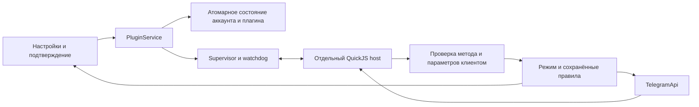

# JellyPlugins v2

Исходники новой системы подключены к клиенту. Старый путь исполнения удалён без адаптера и миграции. Нативная сборка и визуальная проверка ещё не выполнены; результаты Actions нужны до выпуска.

## Исполнение и разрешения



- `contract.json`: единственный каталог методов и бюджетов. `generate.mjs` создаёт `sdk.d.ts`, `client/contract.generated.h` и `host/bootstrap.generated.h`. Клиент независимо проверяет запросы host.
- `runtime.mjs`: приватный bridge, защищённые встроенные объекты, асинхронная активация, события без перекрытия. `ready` означает завершение активации; `turnComplete` служит watchdog транспорта.
- `host/`: Qt-free C++/QuickJS executable. Использует ту же закреплённую ревизию QuickJS-ng, что клиент. Загружается исходный ESM-код, нет загрузчика внешних модулей, Node.js, Python, bytecode или quickjs-libc.
- `client/`: проверка пакета/действия, режимов и правил; Supervisor, платформенный launcher, атомарный Store и монотонный Scheduler. Этот слой требует только Qt Core.
- `Telegram/SourceFiles/jel/plugins/plugin_service.*`: состояние экземпляров, очередь подтверждений, расписания, лимиты и обновления. `plugin_telegram.*` выполняет проверенные Telegram-запросы.
- `settings_plugins.cpp`: глобальный/личный режим, реальные действия, правила, JSON-настройки, код, журнал, откат и удаление.

Режимы: спрашивать; использовать сохранённые правила; полный доступ к реализованному API клиента. Для отдельного плагина доступно наследование глобального режима. Явный сохранённый запрет действует и в полном режиме. Категории манифеста описывают намерения и не выдают права. В подтверждении отправки показаны аккаунт, адресат/ID, полный текст, уведомление и отсутствие предпросмотра ссылок. Можно разрешить один раз, запомнить точное действие либо явно разрешить разные тексты в этом чате с тем же режимом уведомления. Отказы и разрешения удаляются отдельно или вместе.

Поддерживаемый API: `telegram.sendText`, `telegram.readHistory`, `schedule.every`, `schedule.cancel`, `storage.get`, `storage.set`. Локальные настройки, storage и расписания не требуют доступа к аккаунту. HTTP, файлы, пользовательские меню и формы в эту реализацию не входят.

## Пакеты и состояние

`.jelly` — JSON версии 2, строгий манифест и один ESM-бандл с default export функции активации. Top-level await, внешние импорты, нативные зависимости и архивы не поддерживаются. Установка не запускает код. Обновление и откат останавливают старый экземпляр и сбрасывают его права; код и данные переключаются одним атомарным файлом. Хранится один предыдущий снимок. SHA-256 определяет ревизию содержимого, но не удостоверяет автора.

Данные находятся в `tdata/jelly-v2/accounts/<account>/plugins` внутри рабочего каталога клиента. Лимиты аккаунта находятся отдельно в `meta`. Старые данные не импортируются. После аварийного завершения требуется ручное включение. Неизвестный исход отправки не вызывает автоматическую повторную отправку. Расписание работает, пока открыт клиент: пропущенные интервалы не догоняются пачкой, один обработчик не перекрывается сам с собой.

## Платформы и упаковка

| Платформа | Путь helper | Изоляция |
|---|---|---|
| Windows | `jelly-runtime/jelly-plugin-host.exe` рядом с клиентом | AppContainer без capabilities, Job Object, три IPC handles |
| Linux | `jelly-runtime/jelly-plugin-host`; пакетный fallback `libexec/gummygram` | no_new_privs, seccomp, закрытие лишних fd, ограничения ресурсов |
| macOS | `.app/Contents/Helpers/jelly-plugin-host` | собственная подпись с единственным entitlement `com.apple.security.app-sandbox=true` |

Host включён в CMake, portable/update-пакеты и Windows installer. Qt Qml для плагинов не требуется. Основное приложение не копируется в AppData. При недоступной изоляции запуск завершается ошибкой.

`Telegram/build/verify_jelly_runtime.py` проверяет расположение и совпадение архитектур. `sign_jelly_host.py` подписывает macOS helper отдельно от широких прав основного приложения и проверяет entitlements. Linux x86_64/aarch64 предусмотрены в seccomp; CI сейчас проверяет x86_64. Минимальные версии ОС, Store/Flatpak/AppImage и runtime-поведение подписанных релизов требуют отдельных испытаний.

## Проверки

Из каталога `jellyplugins`:

```sh
npm ci
npm run generate
npm run check
npm test
npm run pack:hello
```

Native tests предназначены для CI, локальные правила репозитория запрещают собирать проект. Workflow `.github/workflows/jellyplugins-v2.yml` выполняет JS/TS, Python packaging tests, сборку host и Qt Core tests, реальные protocol/isolation smoke tests на Linux, Windows, Apple Silicon и Intel macOS. Он вызывается release/canary до сборок клиента; доступен ручной запуск и PR-проверка.

Core tests проверяют матрицу режимов, изменение фактических параметров, запреты, защищённые чтения, атомарные снимки, повреждённое состояние, интервалы, асинхронную готовность и внешний watchdog. `host_smoke.py` проверяет реальный native host, бюджет JS/microtasks и тестовые попытки доступа к файлам/loopback без Telegram-отправок. Проверки файла/loopback не доказывают невозможность всех обходов sandbox.

До выпуска нужны успешные Actions, ручная проверка реальной отправки/чтения, нескольких аккаунтов, сна/перезапуска, подписанных установщиков и UI при разных языках/масштабах. [План](../../docs/maintainers/jellyplugins-v2-plan.md).
